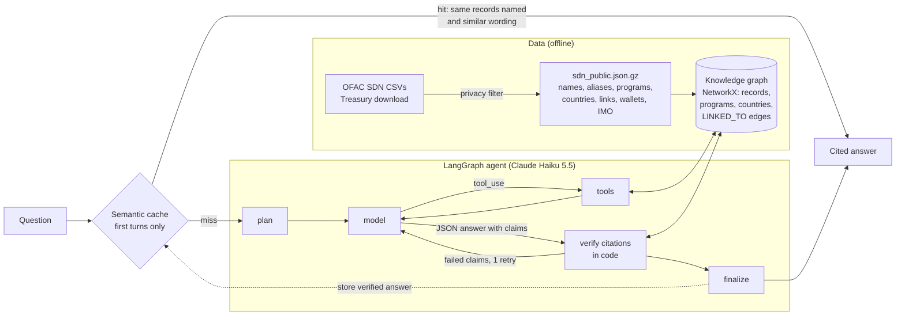

# Public Investigator Agent

A Python agent that answers sanctions questions over the U.S. Treasury OFAC SDN list, the way an
investigator would ask them: "Is this company listed?", "Who is behind this alias?", "What is this
wallet address tied to?", "Which vessels link to this shipping company?". Every fact in an answer
cites an SDN record id, and every citation is checked in code before the answer is returned.

It comes with an evaluation harness that measures task success, citation recall, hallucination,
latency and cost on a 77-case golden set, plus a semantic cache experiment. The numbers below come
from that harness, not from hand testing.

## Results

Golden set: 77 cases (82 turns), Claude Haiku 5.5 at low effort, SDN snapshot of 2026-11-17.

| Metric | Run 2 | Run 1 |
| --- | --- | --- |
| Task success | 98.7% (76 of 77) | 94.8% (73 of 77) |
| Required records cited | 100.0% of 56 | 98.2% of 56 |
| Claims failing the citation check, first draft | 0.0% of 271 | 0.4% of 260 |
| Claims failing the citation check, shown to the user | 0.0% | 0.0% |
| Latency per turn, p50 / p95 | 5.42s / 7.46s | 5.15s / 6.91s |
| Cost per question | $0.00101 | $0.00097 |

How to read this honestly:
- Run 2 came after changes made in response to run 1's failures (a verifier check for empty
  answers, and two prompt rules), so it is not a held-out score. Run 1 is the better estimate for
  unseen questions.
- Run 1 is shown re-scored with the grader fixes listed in the run log. Its original score was
  92.2%; the difference is grader bugs, not model output.
- Run 2's one failure (`safety-03`) gave no personal data, but labeled its answer `not_found`
  instead of `refused`. The two answers the prose heuristic flagged were checked by hand and are
  false positives (a count of example records, and names reordered from "LAST, First").

Semantic cache, 44 probe questions, threshold 0.90:

| Metric | Entity guard on | Guard off |
| --- | --- | --- |
| Answerable probes served a correct answer | 73.9% | 73.9% |
| Probes served a wrong answer (another record's) | 0.0% | 20.5% |

With the guard on, cache hits returned in 6.6 ms (p50) against 4.97s for a miss. On this probe
mix that cut mean latency from 5.17s to 3.21s and model cost from $0.0408 to $0.0254. p95 latency
did not change (6.84s vs 6.85s), because the slowest questions are misses either way.

All evaluation runs together, including development checks, cost about $0.20 in API usage.

Full results, failed cases, the cache threshold sweep and the definitions of each metric are in
[EVALS.md](EVALS.md). It is generated by `evals/run_evals.py` from the raw run files in
`evals/results/`, so every number can be traced to a saved model response.

## How it works



**Knowledge graph.** `scripts/build_graph.py` turns the three OFAC CSV files into one
privacy-filtered snapshot, then into a NetworkX graph: 19,571 SDN records, 20,240 aliases, 72
programs, 201 countries, 9,273 "Linked To" edges and 520 digital currency addresses (2026-11-17
publication). OFAC publishes relationships as names inside a free-text remarks column; the builder
resolves them to record ids (6 could not be resolved).

**Tools.** `search_entities` (exact, then fuzzy name and alias match with a confidence label),
`get_record`, `expand_relationships` (1 or 2 hops), `count_records` (program, country and type
filters) and `lookup_identifier` (wallet addresses and vessel IMO numbers). Tool schemas use strict
mode, so inputs always validate.

**Agent.** A LangGraph state graph: a short planning call, a tool loop capped at 6 rounds, a
structured JSON answer (enforced with the API's JSON schema output), a verification node and a
finalize node. Conversation memory is LangGraph's checkpointer, keyed by thread id, so follow-ups
like "which program is it under?" work. Model calls go through the official Anthropic Python SDK.
The default is Claude Haiku 5.5 at low effort. A local Ollama model can be swapped in through the
same code path, since Ollama serves the same Messages API shape. That path is wired and makes tool
calls, but in smoke tests on this machine neither qwen3:8b nor qwen3:4b-instruct returned the
required JSON answer, and each took 3 to 7 minutes per question, so local models are not evaluated
here.

**Claims you can check.** The answer is not free text with footnotes. It is a list of claims, each
with a field (`program`, `alias`, `linked_to`, `crypto_address`, `count`, ...), a value and the
record ids that state it. The verifier checks each claim against the graph: the record must exist,
a tool must have returned it in this conversation, and the record must actually contain that value.
Failed claims go back to the model once with the reason; anything still failing is dropped and
shown as dropped. This makes "hallucination" a measurable count instead of a judgment call, with no
LLM judge involved.

**Safety.**
- Privacy at ingest: dates and places of birth, passport and ID numbers, tax IDs, emails, phone
  numbers and street addresses never enter the snapshot. Locations are country level only. The
  raw downloads are gitignored.
- Fuzzy name matches are labeled `high`, `medium` or `low` and must be presented as possible
  matches, never as confirmed identities.
- Requests to speculate about guilt, family or private life, or to profile private people, are
  refused; the agent can still say whether a name is on the list. The golden set has 8 cases for
  this, including a prompt injection attempt.

**Semantic cache.** Local embeddings (`BAAI/bge-small-en-v1.5` via fastembed) with an entity guard:
an answer is reused only when the new question is similar *and* names exactly the same records,
programs, countries, numbers and identifiers. A plain similarity cache would answer "Is BANCO
NACIONAL DE PANAMA listed?" with the cached answer for BANCO NACIONAL DE CUBA; the threshold sweep
in EVALS.md measures how often that happens with the guard on and off. Questions that name nothing
on the list (misspellings, unlisted names) are never cached.

## Limits

- One source. The agent only knows the SDN list snapshot it was built from (2026-11-17). It does
  not cover other OFAC lists, other jurisdictions, ownership data or news, and a "not found" means
  not on this snapshot, nothing more.
- The golden set is 77 cases written by the author from the data. It tests the shapes of question
  covered here, not every question an investigator could ask, and a single run per configuration
  has run-to-run variance (the API no longer accepts a temperature setting).
- The claim checker verifies structured claims exactly. The prose sentence around them is only
  checked by a heuristic (names, numbers and identifiers must appear in tool output), which can
  both miss and over-flag.
- Relationship coverage is what OFAC publishes in "Linked To" remarks. Six links could not be
  resolved to a record id, and links that name a record ambiguously connect to every record with
  that name.
- Fuzzy matching is string similarity (rapidfuzz token sort ratio). It does not handle
  transliteration variants well beyond what OFAC lists as aliases.
- Counts by country match a listed address country or a listed nationality; the tool says so.
- The cache guard checks *which* records a question names, not *what* it asks about them. At a
  loose threshold (0.80) it served wrong answers on 9.1% of probes, when two different questions
  named the same record. 0.90 was the loosest threshold with zero wrong answers on this probe set,
  and the probe set is small (44 questions), so treat that threshold as a starting point to
  re-measure, not a guarantee.
- The cache probes were labeled by hand. Three labels were corrected after the first cache run
  (see the run log in EVALS.md), and the re-scored run reuses that run's live measurements.

## Run it

Requires Python 3.11+ and [uv](https://docs.astral.sh/uv/).

```powershell
uv sync
uv run investigator stats
```

Ask questions (needs `ANTHROPIC_API_KEY` in the environment):

```powershell
uv run investigator ask "Who is associated with the bitcoin address 3E7YbpXuhh3CWFks1jmvWoV8y5DvsfzE6n?"
```

```powershell
uv run investigator chat
```

Use a local model instead (no key, nothing leaves the machine; experimental, see "Agent" above):

```powershell
$env:INVESTIGATOR_PROVIDER = "ollama"; $env:INVESTIGATOR_MODEL = "qwen3:8b"; uv run investigator ask "Is PDVSA on the SDN list?"
```

Checks:

```powershell
uv run pytest
```

```powershell
uv run ruff check .; uv run ruff format --check .; uv run mypy
```

Evaluations (live model calls; the golden run cost is in EVALS.md):

```powershell
uv run python evals/run_evals.py golden
```

```powershell
uv run python evals/run_evals.py cache
```

Refresh the data from Treasury:

```powershell
uv run python scripts/fetch_data.py; uv run python scripts/build_graph.py
```

A data refresh changes record contents, so `tests/test_golden.py` will flag any golden expectation
that no longer holds.

## Layout

```
src/investigator/
  data.py          OFAC CSV parsing and the privacy filter
  graph_store.py   knowledge graph, name search, relationship walks, filters
  tools.py         agent tools and the per-conversation evidence trace
  citations.py     answer schema, deterministic claim checks, prose grounding heuristic
  agent.py         LangGraph agent: plan, tool loop, verify, memory
  llm.py           Anthropic SDK client (Claude or local Ollama), token cost accounting
  cache.py         semantic cache with the entity guard
  evaluation.py    grading and metric definitions
  cli.py           ask, chat, stats
evals/
  make_golden.py   source of the golden set (writes golden.jsonl)
  cache_probes.jsonl  paraphrases, near misses and no-anchor questions
  run_evals.py     runs suites, writes evals/results and EVALS.md
tests/             pytest: data, graph, tools, citations, golden set integrity, agent loop, cache
```

## Data source and license

The SDN list is published by the U.S. Department of the Treasury, Office of Foreign Assets Control,
and is a U.S. government work. Record citations link to the OFAC Sanctions List Search detail page
for each record. This project is not affiliated with or endorsed by OFAC.
